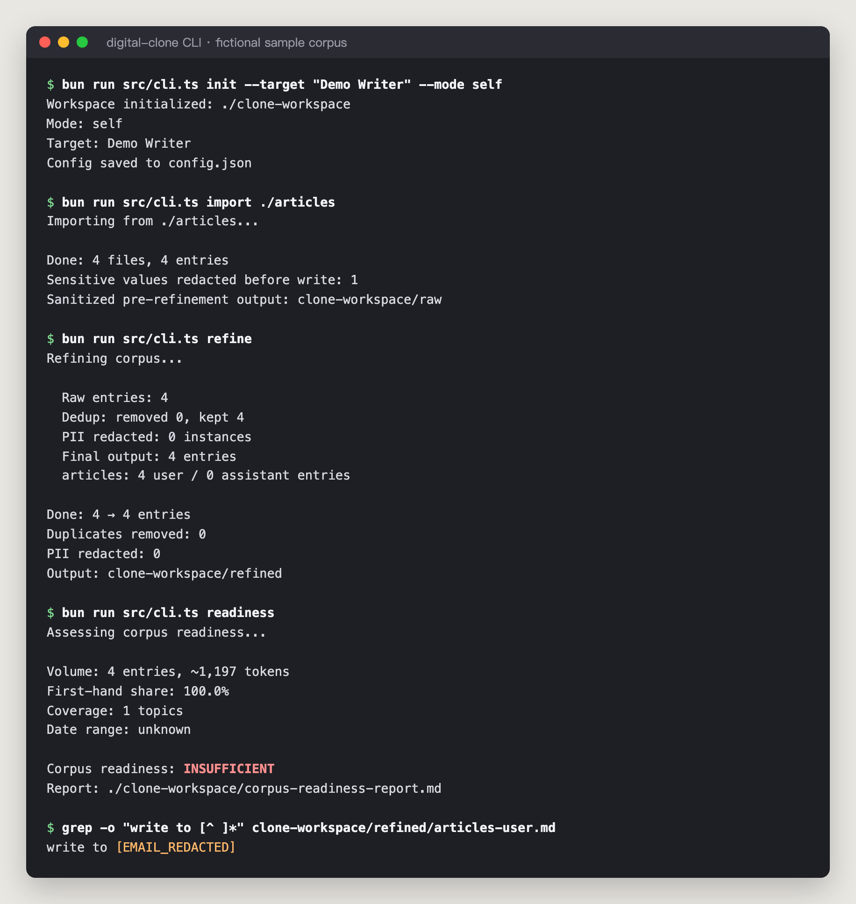

<div align="center">

# Digital Clone

**语料驱动的数字分身 Claude Code Skill**

*采集你的 AI 对话，提取你的人格特质，部署一个说话像你的分身。*

一个 Claude Code Skill，把对话历史和写作转化为数字分身——引导你完成语料采集、清洗、人格提取、System Prompt 生成和验证全流程。附带可选的 Bun CLI/MCP 工具做机械性数据预处理。

[](LICENSE)
[](https://claude.com/claude-code)

[English](README.md) | **简体中文**

</div>

> **状态：** 仅维护 · 2026-10 最后核验。代码稳定、CI 为绿，但作者自 2026 年 6 月起已不在日常使用；没人走的路径上的已知问题不主动修。它的现役后代是 [etwin-bot](https://github.com/AliceLJY/etwin-bot)。

---

## 它能做什么

**适合谁：** 手里有大量自己写的文字和 AI 对话、想要一个*写作风格校准器*——一份按自己的方式回答问题的 System Prompt——而不是又一个通用助手的人。作者本人就是这样用的，第一个克隆对象就是她自己。目前外部使用者很少。来龙去脉见 [docs/story.md](docs/story.md)。

Skill 引导你走完 6 阶段流程，全程对话式——不需要任何运行时依赖：

| 阶段 | 名称 | 做什么 |
|------|------|--------|
| 1 | 目标画像 | 确定克隆目标，盘点数据源 |
| 2 | 语料搜集 | 采集已做隐私脱敏的语料（对话记录、文章、调研） |
| 3 | 语料清洗 | 清洗、去重、二次脱敏、语料就绪度评估 |
| 4 | 灵魂锻造 | 提取人格，生成 System Prompt |
| 5 | 验证测试 | 陷阱问题测试，附通过标准（目标：≥80%） |
| 6 | 部署上线 | 平台部署指南（NotebookLM / bot / 通用 LLM） |

### 两种模式

- **Self Mode** —— 从本地 AI 对话和写作克隆自己
- **Mentor Mode** —— 通过 6 角度并行调研克隆名人（本人原声、即兴反应、外部评价、决策记录、社交碎片、时间线）

---

## 快速开始

安装 Skill（这就是全部安装步骤）：

```bash
mkdir -p ~/.claude/skills/digital-clone
curl -o ~/.claude/skills/digital-clone/SKILL.md \
  https://raw.githubusercontent.com/AliceLJY/digital-clone-skill/main/SKILL.md
```

然后在 Claude Code 里说：

> 帮我克隆自己，用我的公众号文章和 CC 对话记录
> 帮我克隆纳瓦尔做数字导师

Skill 会逐阶段对话式推进，每一步都等你确认。所有产出落在当前目录的 `./clone-workspace/`。

---

## 可选：CLI 预处理工具

> **需要 [Bun](https://bun.sh)。** CLI 无法在 Node.js 下运行（依赖 Bun 的 TypeScript 模块解析）。不用 Bun 的话可以完全跳过本节——Skill 自身覆盖完整流程。

语料量很大时（数千个 transcript 文件），CLI 做机械性工作比对话内处理更快：

```bash
git clone https://github.com/AliceLJY/digital-clone-skill.git
cd digital-clone-skill
bun install   # 也可以 npm ci（CI 用仓库里的 package-lock.json）；CLI 本身仍须在 Bun 下运行

bun run src/cli.ts init --target "你的名字" --mode self
bun run src/cli.ts ingest --source all
bun run src/cli.ts refine
bun run src/cli.ts readiness
```



**重要：** workspace 路径相对于运行命令的目录。如果用 CLI 预处理，请在同一目录启动 Claude Code 会话，Skill 才能找到 `./clone-workspace/`。清洗后的语料会区分 `*-user.md`（你的原声——用于人格提取）和 `*-assistant.md`（AI 回复——仅作参考，不进灵魂锻造）。

**隐私边界：** ingest/import 会先在内存中对常见敏感值做尽力脱敏，再首次写入 `raw/*.jsonl`；不会先写一份未过滤副本、再覆盖它。`raw/` 仍包含私人对话正文，规则也不可能识别所有凭证和个人信息，分享或上传前必须人工检查。加 `--no-raw` 可只扫描和报告，完全不生成 raw 语料文件。refine 仍会对旧文件或手动放入的文件再做一次脱敏，原始源文件不会被修改。

| 命令 | 说明 |
|------|------|
| `bun run src/cli.ts init` | 初始化工作区和配置 |
| `bun run src/cli.ts ingest --source <src> [--no-raw]` | 扫描语料，写入前脱敏，也可完全不写 raw 文件 |
| `bun run src/cli.ts import <path> [--no-raw]` | 按同样的隐私规则导入外部文件（Mentor Mode） |
| `bun run src/cli.ts refine` | 清洗、去重、脱敏 |
| `bun run src/cli.ts readiness` | 生成语料就绪度报告 |
| `bun run src/cli.ts stats` | 显示语料统计 |
| `bun run src/cli.ts verify-template` | 生成测试用例模板 |
| `bun run src/cli.ts deploy-guide --platform <p>` | 生成部署指南 |
| `bun run src/cli.ts refresh` | 重扫数据源，把新内容合并进清洗后的语料 |


### 支持的语料来源

`ingest --source <src>` 内置以下解析器：

| 来源 | 读取 | 说明 |
|------|------|------|
| `cc` | Claude Code 对话记录（`~/.claude/projects`） | 自动探测 |
| `codex` | Codex CLI 会话（`~/.codex/sessions`） | |
| `gemini` | Gemini CLI 历史文件（`~/.gemini/tmp`） | 只能读旧历史——Google 已于 2026-06-18 停止个人账号的 Gemini CLI |
| `memory` | Claude Code 记忆文件（`~/.claude/projects/*/memory`） | 自动探测 |
| `articles` | 你自己写的 `.md` / `.txt` / `.html` 文章目录 | 默认关闭，需在 `config.json`（`init` 生成）或 `~/.config/digital-clone/config.json` 里设 `sources.articles.path` 并启用 |

Kimi、Antigravity、ChatGPT 等工具没有内置解析器。把这些对话导出成 `.md` / `.txt` / `.html`，再用 `import <path>` 导入。`refresh` 还可以从 RecallNest 拉取近期记忆（见下文）。

设置 `CLONE_WORKSPACE` 环境变量可以把 workspace 固定到一个路径，让 CLI 和 Skill 会话共享。

`bun run src/cli.ts quality` 作为 `readiness` 的兼容别名继续可用；输出和报告统一使用“语料就绪度”，因为这些指标衡量的是语料是否充分，不是分身质量。

> `refresh` 可以顺带从 [RecallNest](https://github.com/AliceLJY/recallnest) 导出近期记忆（作者自己的记忆系统；设 `RECALLNEST_CLI` 或安装在 `~/recallnest/lm`）。导出内容会先从 stdout 捕获到内存并完成脱敏，再首次写入 `refreshed/`。没装的话用 `--skip-recallnest`。

<details>
<summary><strong>MCP 工具（共 6 个，含一个兼容别名，同样需要 Bun）</strong></summary>

| 工具 | 说明 |
|------|------|
| `clone_ingest` | 扫描和采集语料 |
| `clone_refine` | 清洗和去重 |
| `clone_corpus_readiness` | 评估语料是否足以进入人格提取 |
| `clone_quality` | `clone_corpus_readiness` 的弃用兼容别名 |
| `clone_stats` | 显示统计 |
| `clone_read_corpus` | 读取清洗后的语料片段（默认只取 user 侧文本） |

**MCP 配置（Claude Code）：**

```json
{
  "mcpServers": {
    "digital-clone": {
      "command": "bun",
      "args": ["run", "/path/to/digital-clone-skill/src/mcp-server.ts"],
      "cwd": "/path/to/digital-clone-skill"
    }
  }
}
```

</details>

<details>
<summary><strong>架构</strong></summary>

| 文件 | 职责 |
|------|------|
| `SKILL.md` | Claude Code Skill —— 完整 6 阶段流程（产品本体） |
| `src/cli.ts` | 可选 CLI 入口（Bun） |
| `src/mcp-server.ts` | 可选 MCP 工具（Bun） |
| `src/parsers.ts` | 多源 transcript 解析 |
| `src/ingest.ts` | 语料采集管道 |
| `src/sanitize.ts` | 写入前共用的敏感信息脱敏 |
| `src/refine.ts` | 全文哈希去重 + 二次脱敏 + 格式统一 |
| `src/readiness.ts` | 语料就绪度评估 + 报告 |
| `src/quality.ts` | 弃用 API 兼容层 |
| `src/templates.ts` | 验证和部署模板生成 |
| `src/config.ts` | 配置管理 |

</details>

---

## 致谢

| 来源 | 贡献 |
|------|------|
| Claude Code | 基础架构、CLI、MCP、解析器 |
| [RecallNest](https://github.com/AliceLJY/recallnest) | 对话记录解析器架构（本 skill 只带 Claude Code、Codex、Gemini CLI 历史文件三种解析器） |
| [@MinLiBuilds](https://x.com/MinLiBuilds) | Naval 克隆教程 —— 最初的灵感来源 |
| alchaincyf/nuwa-skill | 6 角度调研 + 三遍验证 |
| LvPengfei1/PersonaVault | 证据分级 + 能力边界 |

## 作者

作者是 **小试AI**（[@AliceLJY](https://github.com/AliceLJY)），公众号为 **我的AI小木屋**。


## 生态

**小试AI** 开源 AI 工作流生态的一部分：

| 项目 | 简介 |
|------|------|
| [recallnest](https://github.com/AliceLJY/recallnest) | MCP 记忆工作台（LanceDB + Jina v5） |
| content-publisher（私有仓） | 配图 + 排版 + 公众号发布 |
| [telegram-ai-bridge](https://github.com/AliceLJY/telegram-ai-bridge) | 自托管 Telegram 桥，可驱动 Claude Code / Codex / Agy / Kimi |
| [claude-code-studio](https://github.com/AliceLJY/claude-code-studio) | Claude Code 多会话协作平台 |
| cc-empire *(private)* | 完整的 Claude Code 工作流脚手架（规则 + 钩子 + agent） |
| [etwin-bot](https://github.com/AliceLJY/etwin-bot) | E-Twin Telegram bot —— 本 skill 的 1:1 实例化部署 |

## 许可证

MIT
